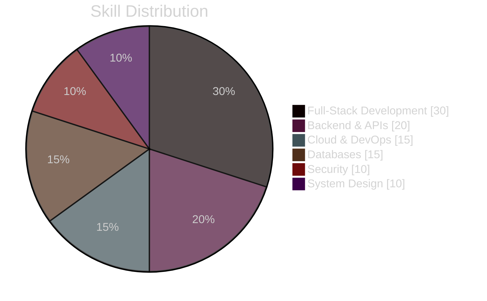
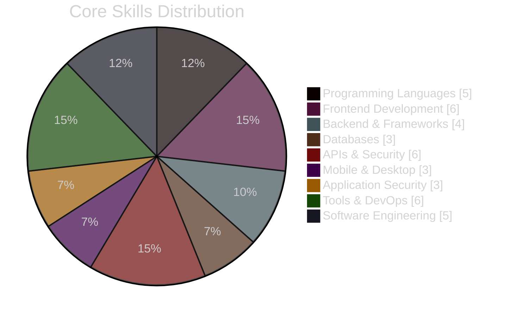
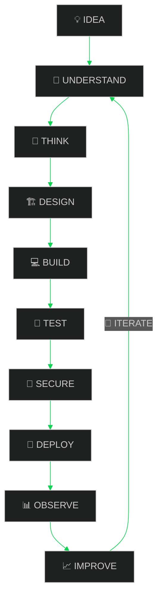

<!-- ========================================================= -->
<!--                 MR. AHAMED | GITHUB PROFILE               -->
<!-- ========================================================= -->

 

<!-- ======================= ANIMATED GLOW HALO (TOP) ======================= -->

<!-- ======================= NAME HEADER (TYPES ONCE) ======================= -->

 

<!-- ======================= ANIMATED GLOW HALO (BOTTOM) ======================= -->

 

<!-- ======================= 7 ROLE POINTS (TYPING - LOOPING) ======================= -->

 

<strong>💼 Open to Software Engineering / Full-Stack Development Internship Opportunities</strong>

<em>
Building scalable, secure and user-focused software while continuously
learning modern software engineering practices.
</em>

<!-- Animated Snake Divider -->

 

<!-- ========================================================= -->
<!--                         SOCIALS                            -->
<!-- ========================================================= -->

 

<!-- ========================================================= -->
<!--                    PROFILE BADGES                          -->
<!-- ========================================================= -->

 

<!-- ========================================================= -->
<!--                     ANIMATED DIVIDER                       -->
<!-- ========================================================= -->

 

<!-- ========================================================= -->
<!--                         ABOUT ME                           -->
<!-- ========================================================= -->

## 👨‍💻 About Me

I'm <strong>Mr. Ahamed</strong>, a <strong>Computer Science Undergraduate</strong> and <strong>Full-Stack Developer</strong> who enjoys turning ideas into practical, scalable and secure software.

I enjoy exploring software from the frontend to backend services, databases, infrastructure and deployment while continuously improving my engineering skills through real-world projects.

### ⚡ Quick Profile

- 🎓 <strong>Computer Science Undergraduate</strong>
- 💻 <strong>Full-Stack Developer</strong>
- 🎨 <strong>UI/UX Designer</strong>
- 🌐 <strong>Web Developer</strong>
- 🚀 <strong>Aspiring Software Engineer</strong>
- 🔐 <strong>Cybersecurity Enthusiast</strong>
- ☁️ <strong>Cloud & DevOps Explorer</strong>
- 🗄️ <strong>Database & API Development</strong>
- 🧩 <strong>Software Architecture & System Design</strong>
- 🧠 <strong>Problem-Solving Mindset</strong>
- 🤝 <strong>Open to Collaboration</strong>
- 🌱 <strong>Always Learning & Building</strong>

### 🧠 Why I Build

> I believe good software is not just about writing code.  
> It is about understanding the problem, thinking deeply, designing thoughtfully, building reliably, securing responsibly and continuously improving.

### 🎯 My Goal

> To grow into a strong <strong>Software Engineer</strong> by gaining practical industry experience, contributing to meaningful projects and continuously improving my technical and problem-solving abilities.

 

<!-- ========================================================= -->
<!--                    INTERNSHIP STATUS                       -->
<!-- ========================================================= -->

## 💼 Internship Availability

  

<strong>📩 I am actively looking for internship opportunities where I can learn, contribute, collaborate and grow as a software engineer.</strong>

 

<!-- ========================================================= -->
<!--                    WHAT I LIKE BUILDING                    -->
<!-- ========================================================= -->

## 🛠️ What I Like Building

<table>
<tr>

<td width="50%" valign="top" align="center">

### 🌐 Applications

🖥️ Full-Stack Web Apps 
⚙️ Backend Services & APIs 
🗄️ Database-Driven Systems 
🔐 Authentication & Secure Apps 
📊 Data-Driven Applications

</td>

<td width="50%" valign="top" align="center">

### ☁️ Engineering

☁️ Cloud-Ready Applications 
🐳 Containerized Systems 
🔄 CI/CD & Automation 
📈 Scalable Architectures 
🚀 Reliable Deployment Workflows

</td>

</tr>
</table>

 

<!-- ========================================================= -->
<!--                    FOCUS AREAS CHART                       -->
<!-- ========================================================= -->

## 📊 Focus Areas Overview

 

<!-- ========================================================= -->
<!--                         TECH STACK                         -->
<!-- ========================================================= -->

# 💻 Tech Stack

<!-- ========================================================= -->
<!--                      FRONTEND                              -->
<!-- ========================================================= -->

## 🎨 Frontend Development

 

<!-- ========================================================= -->
<!--                       BACKEND                              -->
<!-- ========================================================= -->

## ⚙️ Backend Development

 

<!-- ========================================================= -->
<!--                    PROGRAMMING LANGUAGES                   -->
<!-- ========================================================= -->

## 🧠 Programming Languages

 

<!-- ========================================================= -->
<!--                         DATABASES                          -->
<!-- ========================================================= -->

## 🗄️ Databases & Data

 

<!-- ========================================================= -->
<!--                    CLOUD & DEVOPS                          -->
<!-- ========================================================= -->

## ☁️ Cloud, DevOps & Infrastructure

 

<!-- ========================================================= -->
<!--                 AI & DATA SCIENCE                          -->
<!-- ========================================================= -->

## 🤖 AI, Data Science & Computer Vision

 

<!-- ========================================================= -->
<!--                VERSION CONTROL & TOOLS                     -->
<!-- ========================================================= -->

## 🔧 Version Control, OS & Developer Tools

 

<!-- ========================================================= -->
<!--                  CMS & PRODUCTIVITY                        -->
<!-- ========================================================= -->

## 🛒 CMS, Payments & Productivity

 

<!-- ========================================================= -->
<!--                       UI / UX                              -->
<!-- ========================================================= -->

## 🎨 UI/UX, Design & Creative Tools

 

<!-- ========================================================= -->
<!--                    MOBILE DEVELOPMENT                      -->
<!-- ========================================================= -->

## 📱 Mobile Development

 

<!-- ========================================================= -->
<!--                    TESTING                                -->
<!-- ========================================================= -->

## 🧪 Testing & Quality Assurance

 

<!-- ========================================================= -->
<!--                      CORE SKILLS                           -->
<!-- ========================================================= -->

## 🧩 Core Skills

### 💻 Programming Languages

 

### 🎨 Frontend Development

 

### ⚙️ Backend & Frameworks

 

### 🗄️ Databases

 

### 🔐 APIs & Security

 

### 📱 Mobile & Desktop Development

 

### 🛡️ Application Security

 

### 🔧 Tools, DevOps & Version Control

 

### 🧠 Software Engineering & Methodologies

 

### 📊 Skill Coverage Overview

 

<!-- ========================================================= -->
<!--                    DEVELOPMENT MINDSET                     -->
<!-- ========================================================= -->

## ⚡ Development Mindset

<table>
<tr>
<td align="center">

### 💡 UNDERSTAND
Understand the problem before writing the solution.

</td>
<td align="center">

### 🧠 THINK
Question assumptions and think beyond the obvious.

</td>
</tr>

<tr>
<td align="center">

### 🏗️ BUILD
Turn ideas into reliable and meaningful software.

</td>
<td align="center">

### 🧪 TEST
Validate, debug and learn from every iteration.

</td>
</tr>

<tr>
<td align="center">

### 🔐 SECURE
Build with security, responsibility and trust in mind.

</td>
<td align="center">

### 📈 IMPROVE
Refine what exists and continuously become better.

</td>
</tr>
</table>

 

<!-- ========================================================= -->
<!--                    GITHUB ANALYTICS                        -->
<!-- ========================================================= -->

## 📊 GitHub Analytics

  
    
    
    

  

 

### 🧬 Engineering Philosophy

> **“I don't chase code that merely works; I chase code I can understand, question, refine, and leave better than I found it.”**

`CODE` → `DEBUG` → `TRACE` → `FIX` → `SLEEP` → `REPEAT` ♻️

 

<!-- ========================================================= -->
<!--                    CODE CYCLE ANIMATION                    -->
<!-- ========================================================= -->

  

 

<!-- ========================================================= -->
<!--                  WORKFLOW FLOWCHART                       -->
<!-- ========================================================= -->

## ⚡ Workflow Visualized

 

<!-- ========================================================= -->
<!--                       FOOTER                               -->
<!-- ========================================================= -->

### 🤝 Let's Connect & Build Something Amazing Together

<em>Learn • Build • Secure • Improve</em>

  

 

<!-- ========================================================= -->
<!--               MADE WITH PASSION BY AHAMED                  -->
<!-- ========================================================= -->

  💚 Crafted with <strong>passion</strong>, <strong>precision</strong> & <strong>purpose</strong> by <strong>Mr. Ahamed</strong>

